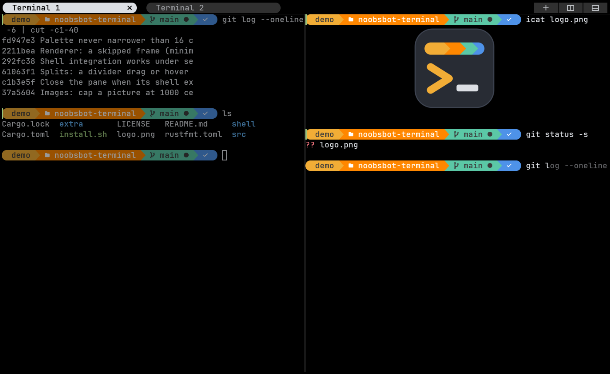
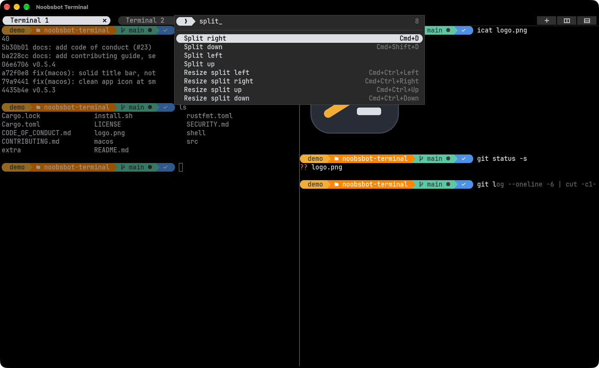
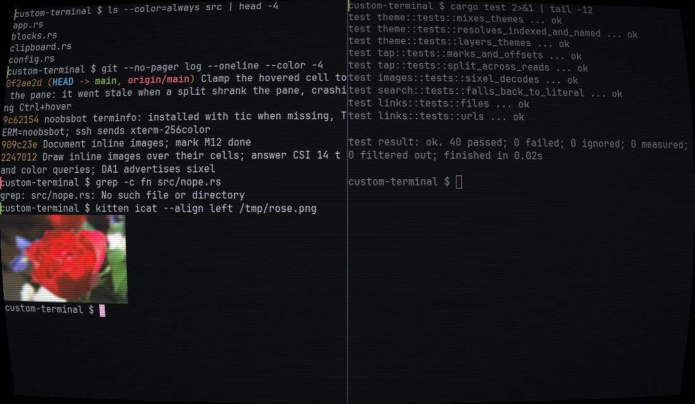
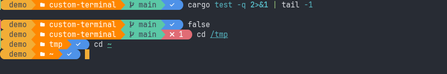

# noobsbot terminal

A GPU-rendered terminal emulator for Linux, written in Rust. Easy to use, fast,
and it changes its color palette to match the situation: red when you SSH into
production, amber as root, a different look on `main` or after dark.



| Command palette | CRT mode |
|---|---|
|  |  |

See [PLAN.md](PLAN.md) for how it was built, milestone by milestone.

## Install

On Arch, build the package from [extra/aur](extra/aur):

```sh
git clone https://github.com/anil0403/noobsbot-terminal && cd noobsbot-terminal/extra/aur
makepkg -si
```

Elsewhere, with Rust (`rustup default stable`):

```sh
cargo build --release
install -Dm755 target/release/noobsbot ~/.local/bin/noobsbot
install -Dm644 extra/noobsbot.desktop ~/.local/share/applications/noobsbot.desktop
```

`~/.local/bin` must be on your `PATH`. "noobsbot terminal" then shows up in
your desktop's app menu.

Programs inside see `TERM=noobsbot` (on first start noobsbot compiles its
terminfo into `~/.terminfo` if `tic` is around; otherwise TERM stays
`alacritty` or `xterm-256color`). Other machines don't know `noobsbot`, so in
bash and zsh `ssh` sends `TERM=xterm-256color` instead; fish users may want
`alias ssh 'TERM=xterm-256color command ssh'`.

## Keys

| Keys | Action |
|---|---|
| Ctrl+Shift+P | Command palette: every action and theme, type to filter, Enter to run |
| Ctrl+Shift+C / Ctrl+Shift+V | Copy / paste |
| Shift+Insert, middle click | Paste (middle click pastes the mouse selection) |
| Mouse drag, double / triple click | Select text, word, line (copied to the mouse selection) |
| Shift + mouse | Select even when an app (vim, tmux) captures the mouse |
| Shift+PgUp / Shift+PgDn, wheel | Scroll through history |
| Ctrl+Shift+Home / End | Jump to top / bottom of history |
| Ctrl+= / Ctrl+- / Ctrl+0 | Bigger / smaller / reset font |
| Ctrl+Shift+T | New tab (opens in the current shell's directory) |
| Ctrl+Shift+E / Ctrl+Shift+O | Split right / split down |
| Ctrl+Shift+W | Close pane (the last pane closes its tab) |
| Ctrl+Tab / Ctrl+Shift+Tab, Alt+1…9, click | Next / previous / numbered tab |
| Alt+Arrows, click | Move focus between split panes |
| Ctrl+Shift+Arrows, drag the divider | Resize splits |
| Ctrl+Shift+F | Search history (regex, or plain text if it isn't one). Enter / Shift+Enter: older / newer match, Esc: close |
| Ctrl+Shift+Space | Vi mode: `hjkl` `wbe` `0$^` `g` `G` `Ctrl+U/D`, `v` / `V` / `Ctrl+V` select, `y` copy, `/` search, `n` / `N` next, Esc / `q` leave |
| Ctrl+Shift+Z / Ctrl+Shift+X | Scroll to the previous / next command's prompt |
| Ctrl+Shift+G | Copy the last command's output |
| Ctrl + hover / click | Underline / open a link: URLs and terminal hyperlinks in the browser, `file.rs:12[:5]` in `$VISUAL`/`$EDITOR` (in a split, at that line; no editor set: the desktop's default app) |

## Config

`~/.config/noobsbot/config.toml` is created with every option documented on
first launch ([example](config.example.toml)). Changes apply as soon as you
save.

## Shell integration

bash and zsh start with a small script (no dotfile edits; your own rc files
still load) that tells the terminal where prompts, commands and output are and
which directory you're in. Fish does this by itself. You get:

- a mark left of each prompt: green when the command worked, red when it
  failed, yellow while it runs, plus a short red flash around the pane on failure
- prompt jumps and copy-last-output (keys above)
- a desktop notification when a command that ran 10 s or more ends while the
  window isn't focused
- new tabs, splits and `file:line` links use the shell's directory

### Pretty prompt

Set `pretty_prompt = true` under `[terminal]` for a powerline prompt in bash,
zsh or fish, in place of your shell's own: user (and host over SSH), folder,
git branch, and a ✓ or ✗ with the exit code. Its colors come from the theme's
palette, so situation themes recolor it. Icons need a Nerd Font (the default
font is one). It applies to shells started after the change.



## Drop-down (quake) mode

`noobsbot --quake` opens a borderless terminal across the top of the screen
(40 % high), always on top. **F12** shows and hides it from anywhere. If
another program already owns F12, or you're on Wayland, set `quake.hotkey`
in the config (e.g. `"Ctrl+grave"`), or bind `noobsbot --quake` to a key in
your desktop's keyboard shortcuts: running it again toggles the open one.

## Images

Programs can show pictures in the terminal using the kitty graphics protocol
(`kitten icat photo.png`) or sixel (`magick photo.png sixel:-`, `img2sixel`).
Images scroll with the text and stay in the scrollback until their lines
scroll out or are cleared.

## CRT mode

Scanlines, glow, a curved screen and dark corners, like an old monitor.
Toggle it with **Toggle CRT effect** in the command palette (Ctrl+Shift+P),
or turn it on for good with `[crt] enabled = true`. Each effect's strength
is set in `[crt]`; `flicker` is off by default because it redraws
constantly.

## Situation themes

Built-in themes: `default`, `danger`, `root`, `careful`, `night`. `default` is
One Half Dark with the warm amber, teal and blue of powerline prompts (as in
[Pretty PowerShell](https://christitus.com/pretty-powershell/)); tabs, the
palette and the search bar use the same rounded pill look, tinted by each
pane's theme. Powerline separators (U+E0B0–E0B7) are drawn by the terminal to
fill the cell exactly, so oh-my-posh and starship prompts join without seams. Rules in the
config pick one based on what's happening in the terminal; the first rule whose
conditions all match wins, and the switch fades in over 150 ms. Every pane
picks its own theme, and each tab carries its pane's accent color, so an SSH
session to production stays red in the tab bar while you work elsewhere.

```toml
[[rules]]
when = { ssh_host = ["prod-*", "*.prod.example.com"] }
theme = "danger"

[[rules]]
when = { user = "root" }
theme = "root"

[[rules]]
when = { git_branch = ["main", "master"], cwd = "~/work/*" }
theme = "careful"

[[rules]]
when = { hours = "22-6" }
theme = "night"
```

Conditions: `ssh_host`, `user`, `git_branch`, `cwd`, `process` (globs with `*`
and `?`, or a list of them) and `hours`. Detection reads `/proc` and
`.git/HEAD` directly, so nothing is spawned. Out of the box, root and any SSH
host containing "prod" are covered.

Make your own theme by naming it and listing only the colors that differ:

```toml
[themes.ocean]
background = "#0b1a2b"
cursor = "#5fd7ff"
```

## License

[MIT](LICENSE)
