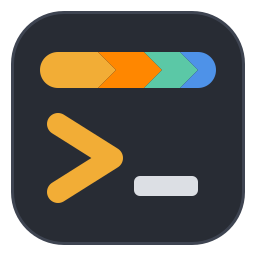
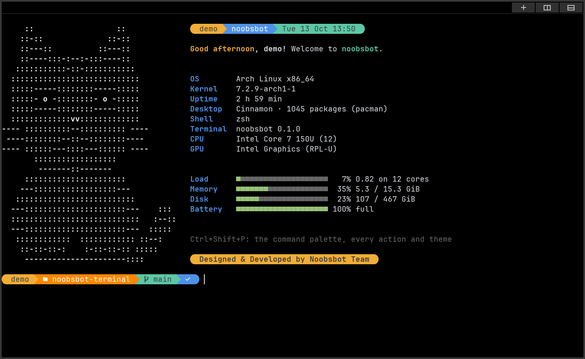

<p align="center">
  
</p>

<h1 align="center">noobsbot terminal</h1>

<p align="center">
  <b>A fast, GPU-rendered terminal for Linux that changes color to match the situation.</b><br>
  Red when you SSH into production, amber as root, a calmer look on <code>main</code> or after dark.
</p>

<p align="center">
  <a href="LICENSE"></a>
  
  
  
</p>

<p align="center">
  <a href="#install">Install</a> ·
  <a href="#features">Features</a> ·
  <a href="#shortcuts">Shortcuts</a> ·
  <a href="#config">Config</a> ·
  <a href="#themes">Themes</a>
</p>


<table>
  <tr>
    <td align="center"><br><sub><b>Command palette</b> (Ctrl+Shift+P)</sub></td>
    <td align="center"><br><sub><b>CRT mode</b></sub></td>
  </tr>
</table>

<a id="install"></a>

## 🚀 Install

Paste this into any terminal. It works on **Arch, Debian/Ubuntu, Fedora and openSUSE**:

```sh
curl -fsSL https://github.com/anil0403/noobsbot-terminal/raw/main/install.sh \
  | bash
```

That command:

- installs every dependency, including **nano** and the **JetBrainsMono Nerd Font** (anything already installed is skipped)
- builds noobsbot and adds **noobsbot terminal** to your app menu
- makes **nano your default editor** for git, gh and the rest, unless you've already picked one
- updates noobsbot when you run it again, or when you run `noobsbot --update` (`noobsbot --version` shows what you have); `noobsbot --restart` (or "Restart noobsbot" in Ctrl+Shift+P) then swaps the window for a fresh one

On Arch it installs the `noobsbot-git` package (`sudo pacman -R noobsbot-git` removes it). Elsewhere noobsbot goes to `/usr/local/bin`, and Rust comes from rustup if your distro's is too old.

**On a Mac?** The macOS port has its own installer; see [macos/](macos/README.md):

```sh
curl -fsSL https://github.com/anil0403/noobsbot-terminal/raw/main/macos/install.sh \
  | bash
```

<details>
<summary><b>Install by hand</b></summary>

<br>

On Arch, build the package from [extra/aur](extra/aur):

```sh
git clone https://github.com/anil0403/noobsbot-terminal && cd noobsbot-terminal/extra/aur
makepkg -si
```

Elsewhere, with Rust (`rustup default stable`):

```sh
cargo build --release
install -Dm755 target/release/noobsbot ~/.local/bin/noobsbot
install -Dm644 extra/noobsbot.desktop ~/.local/share/applications/noobsbot.desktop
install -Dm644 extra/noobsbot.svg ~/.local/share/icons/hicolor/scalable/apps/noobsbot.svg
```

`~/.local/bin` must be on your `PATH`. Also install `nano`: when you haven't set `$VISUAL` or `$EDITOR`, noobsbot sets `EDITOR=nano`, so git, gh and Ctrl+click on `file:line` open it.

Programs inside see `TERM=noobsbot`. On first start noobsbot compiles its terminfo into `~/.terminfo` if `tic` is around; otherwise TERM stays `alacritty` or `xterm-256color`. Other machines don't know `noobsbot`, so in bash, zsh and fish `ssh` sends `TERM=xterm-256color` instead.

</details>

<a id="features"></a>

## ✨ Features

| Feature | What you get |
|---|---|
| 🎨 **Situation themes** | The palette follows what you're doing: SSH host, user, git branch, folder, program, time of day. |
| ⚡ **GPU rendering** | Drawn with wgpu (Vulkan or OpenGL), smooth at your screen's refresh rate. |
| 🐱 **Welcome screen** | A cat beside your machine's specs and live meters that types itself out, gone as soon as you type. |
| 💎 **Pretty prompt** | A powerline prompt for bash, zsh and fish: user, folder, git branch, exit status. |
| 💾 **Session restore** | Opt in, and closing the window keeps its tabs, splits and folders for next time. |
| 🪟 **Tabs and splits** | Split in all four directions from the tab bar, the right-click menu or the keyboard. Zoom one pane to fill the tab and back, or type into all of them at once. |
| 🧭 **Command palette** | Every action, theme and shell, one search away (Ctrl+Shift+P). |
| 💡 **Suggestions** | Grey text after the cursor as you type (bash, zsh): commands that worked in this folder first, then anywhere, then your shell's history, then file names. → takes it. |
| 🔗 **Clickable links** | Click a URL to open it, `c` while hovering copies it; Ctrl+click for terminal hyperlinks and `file.rs:12` paths. Or Ctrl+Shift+L and type a link's letter, no mouse needed. |
| 📂 **Drag and drop** | Drop files from your file manager onto the terminal to type their paths, quoted when they have spaces. |
| 🖼️ **Inline images** | kitty graphics protocol and sixel. |
| 📋 **Copy on select** | Selected text goes straight to the clipboard. |
| 📺 **CRT mode** | Scanlines, glow and a curved screen, like an old monitor. |
| ⬇️ **Drop-down mode** | A quake-style terminal that slides in with F12. |
| 🔔 **Command tracking** | Pass/fail marks per prompt, jump between commands, notifications when long ones finish. A visual bell flashes the pane's border. |

<a id="shortcuts"></a>

## ⌨️ Keyboard shortcuts

**Ctrl+Shift+P** opens the command palette, which lists every action below, so it's the one shortcut worth learning first.

<details open>
<summary><b>Copy and paste</b></summary>

| Keys | Action |
|---|---|
| Ctrl+Shift+C / Ctrl+Shift+V | Copy / paste |
| Ctrl+V | Paste at the shell prompt (programs like vim, nano and Claude Code still get Ctrl+V) |
| Shift+Insert, middle click | Paste (middle click pastes the mouse selection) |
| Mouse drag, double / triple click | Select text, word, line (copied to the clipboard and the mouse selection) |
| Shift + mouse | Select even when an app (vim, tmux) captures the mouse |
| Ctrl+Shift+G | Copy the last command's output |

</details>

<details open>
<summary><b>Tabs and splits</b></summary>

| Keys | Action |
|---|---|
| Ctrl+Shift+T, **+** button | New tab (opens in the current shell's directory) |
| Ctrl+Shift+E / Ctrl+Shift+O | Split right / split down (also the buttons at the right of the tab bar; up and left from the palette or right-click) |
| Right-click | Menu: copy, paste, split right / down / left / up, new tab, close pane (Shift+right-click when a program uses the mouse) |
| Ctrl+Shift+W | Close pane (the last pane closes its tab) |
| **×** on a tab, middle-click | Close the tab with all its panes |
| Ctrl+Tab / Ctrl+Shift+Tab, Alt+1…9, click | Next / previous / numbered tab |
| Alt+Arrows, click | Move focus between split panes |
| Ctrl+Shift+Arrows, drag the divider | Resize splits |
| Ctrl+Shift+B | Broadcast input: typing and pastes go to every pane in the tab (yellow borders while on); again to stop |
| Ctrl+Shift+Enter | Zoom the focused pane to fill the tab, or bring the splits back (Alt+Arrows, a new split or closing a pane also bring them back) |

</details>

<details open>
<summary><b>Scrolling, search and navigation</b></summary>

| Keys | Action |
|---|---|
| Shift+PgUp / Shift+PgDn, wheel | Scroll through history |
| Ctrl+Shift+Home / End | Jump to top / bottom of history |
| Ctrl+Shift+Z / Ctrl+Shift+X | Scroll to the previous / next command's prompt |
| Ctrl+Shift+F | Search history (regex, or plain text if it isn't one), with a match count. Enter / Shift+Enter: older / newer match, Esc: close |
| Ctrl+Shift+Space | Vi mode: `hjkl` `wbe` `0$^` `g` `G` `Ctrl+U/D`, `v` / `V` / `Ctrl+V` select, `y` copy, `/` search, `n` / `N` next, Esc / `q` leave |
| → or End / Ctrl+→ | Take the grey suggestion / its next word |
| Hover a URL: click / `c` | Open it / copy it |
| Ctrl+Shift+L | Link hints: every link on screen gets a letter; type it to open the link, Shift + it to copy, Esc to cancel |
| Ctrl + hover / click | Underline / open a link: URLs and terminal hyperlinks in the browser, `file.rs:12[:5]` in `$VISUAL`/`$EDITOR` (in a split, at that line; no editor set: the desktop's default app) |

</details>

<details open>
<summary><b>View</b></summary>

| Keys | Action |
|---|---|
| Ctrl+Shift+P | Command palette: every action and theme, type to filter, Enter to run. **Shell: zsh / bash / fish** switches the window's shell (a new tab opens with it; later tabs and splits use it too) |
| Ctrl+= / Ctrl+- / Ctrl+0 | Bigger / smaller / reset font |

</details>

<a id="config"></a>

## ⚙️ Config

`~/.config/noobsbot/config.toml` is created on first launch with every option documented ([example](extra/config.example.toml)). Changes apply **as soon as you save**.

To change a shortcut, add a `[keys]` table that names the action as the palette shows it, in snake_case:

```toml
[keys]
split_right = "Ctrl+Shift+D"
zoom_pane = "Ctrl+Shift+Z or F11"
vi_mode = ""   # unbound, still in the palette
```

To pick up where you left off, set `restore_session = true` under `[terminal]`. Closing the window saves its tabs, splits and each shell's folder (in `~/.local/state/noobsbot/session`), and the next window opens them again. Programs that were running aren't restarted, and ending the last shell with `exit` starts the next window fresh.

For a see-through background, set `opacity = 0.85` (0 to 1) under `[terminal]`. Text and colors that programs paint themselves stay solid. It needs a compositor and is ignored while CRT mode is on.

## 🐚 Shell integration

bash and zsh start with a small script that tells the terminal where prompts, commands and output are, and which directory you're in. It doesn't edit your dotfiles, and your own rc files still load. Fish does this by itself. You get:

- a mark left of each prompt: 🟢 the command worked, 🔴 it failed, 🟡 it's still running, plus a short red flash around the pane on failure
- prompt jumps and copy-last-output (see the shortcuts)
- a desktop notification when a command that ran 10 s or more ends while the window isn't focused

Separately, when a program rings the bell, the pane's border flashes in the theme's cursor color, and an unfocused window asks for attention in your taskbar.
- new tabs, splits and `file:line` links that open in the shell's directory

### 💎 Pretty prompt

Set `pretty_prompt = true` under `[terminal]` for a powerline prompt in bash, zsh or fish, in place of your shell's own. It shows:

- the user (and host over SSH)
- the folder
- the git branch, with ● when there are uncommitted changes
- a ✓ or ✗ with the exit code

Its colors come from the theme's palette, so situation themes recolor it. Icons need a Nerd Font (the default font is one). It applies to shells started after the change.


## 🐱 Welcome screen



A new window opens with a cat drawn in text beside a summary of the machine:

- a powerline header with user, host and date
- distro, kernel, uptime, desktop and package count, shell, CPU and GPU
- meters for load, memory, swap, disk and battery that turn green, yellow, then red as they get worse
- a tip pointing to the command palette

The terminal draws it itself from `/proc` before the shell starts, so it costs no startup time and works with any shell. New tabs and splits stay clean, and windows too narrow for it leave the cat out. The first key you press at the prompt (or Enter) clears it. Turn it off with `welcome = false` under `[terminal]`.

## ⬇️ Drop-down (quake) mode

`noobsbot --quake` opens a borderless terminal across the top of the screen (40 % high), always on top. **F12** shows and hides it from anywhere.

If another program already owns F12, or you're on Wayland, set `quake.hotkey` in the config (e.g. `"Ctrl+grave"`). Or bind `noobsbot --quake` to a key in your desktop's keyboard shortcuts: running it again toggles the open one.

## 🖼️ Images

Programs can show pictures in the terminal using the kitty graphics protocol (`kitten icat photo.png`) or sixel (`magick photo.png sixel:-`, `img2sixel`). Images scroll with the text and stay in the scrollback until their lines scroll out or are cleared.

## 📺 CRT mode

Scanlines, glow, a curved screen and dark corners, like an old monitor. Toggle it with **Toggle CRT effect** in the command palette, or turn it on for good with `[crt] enabled = true`. Each effect's strength is set in `[crt]`. `flicker` is off by default because it redraws constantly.

<a id="themes"></a>

## 🎨 Situation themes

Built-in themes: `default`, `danger`, `root`, `careful`, `night`.

`default` uses One Half Dark's colors on black, with the warm amber, teal and blue of powerline prompts (as in [Pretty PowerShell](https://christitus.com/pretty-powershell/)). Tabs, the palette and the search bar share the same rounded pill look, tinted by each pane's theme. The terminal draws powerline separators (U+E0B0–E0B7) itself to fill the cell exactly, so oh-my-posh and starship prompts join without seams.

Rules in the config pick a theme based on what's happening in the terminal. The first rule whose conditions all match wins, and the switch fades in over 150 ms. Every pane picks its own theme and each tab carries its pane's accent color, so an SSH session to production stays red in the tab bar while you work elsewhere.

```toml
[[rules]]
when = { ssh_host = ["prod-*", "*.prod.example.com"] }
theme = "danger"

[[rules]]
when = { user = "root" }
theme = "root"

[[rules]]
when = { git_branch = ["main", "master"], cwd = "~/work/*" }
theme = "careful"

[[rules]]
when = { hours = "22-6" }
theme = "night"
```

| Condition | Matches | Example |
|---|---|---|
| `ssh_host` | host you're SSH'd into | `"prod-*"` |
| `user` | user of the running program | `"root"` |
| `git_branch` | branch of the current repo | `["main", "master"]` |
| `cwd` | current directory | `"~/work/*"` |
| `process` | running program | `"vim"` |
| `hours` | local time range (wraps past midnight) | `"22-6"` |

Text conditions take `*` and `?` globs, or a list of them. Detection reads `/proc` and `.git/HEAD` directly, so nothing is spawned. Out of the box, root and any SSH host containing "prod" are covered.

Make your own theme by naming it and listing only the colors that differ:

```toml
[themes.ocean]
background = "#0b1a2b"
cursor = "#5fd7ff"
```

---

<p align="center">
  <sub>Designed & developed by the Noobsbot Team · <a href="LICENSE">MIT license</a></sub>
</p>
