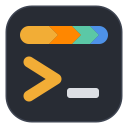

<p align="center">
  
</p>

<h1 align="center">noobsbot terminal for macOS</h1>

<p align="center">
  The macOS port of <a href="../README.md">noobsbot terminal</a>: the same terminal, with Mac keys and Metal rendering.<br>
  Apple Silicon and Intel, macOS 11 or newer.
</p>

## 🚀 Install

Paste this into Terminal:

```sh
curl -fsSL https://github.com/anil0403/noobsbot-terminal/raw/main/macos/install.sh \
  | bash
```

That command:

- installs **Noobsbot.app** in `/Applications` (or `~/Applications`): the latest release, or built from source when there is none (it then asks for the Xcode Command Line Tools and installs Rust with rustup)
- adds the `noobsbot` command (`noobsbot --quake` starts the drop-down terminal)
- installs the **JetBrainsMono Nerd Font** for the prompt's icons
- updates noobsbot when you run it again

The app is signed ad hoc, not by Apple: the installer clears the download quarantine so Gatekeeper doesn't call it damaged. To remove noobsbot, delete `Noobsbot.app` and the `noobsbot` link.

<details>
<summary><b>Build by hand</b></summary>

<br>

```sh
git clone https://github.com/anil0403/noobsbot-terminal && cd noobsbot-terminal/macos
cargo build --release && ./package.sh
cp -R target/Noobsbot.app /Applications/
```

</details>

## ⌨️ Shortcuts

| Action | Keys |
|---|---|
| Command palette (every action, theme and shell) | <kbd>Cmd</kbd>+<kbd>Shift</kbd>+<kbd>P</kbd> |
| Copy · Paste | <kbd>Cmd</kbd>+<kbd>C</kbd> · <kbd>Cmd</kbd>+<kbd>V</kbd> |
| Copy the last command's output | <kbd>Cmd</kbd>+<kbd>Shift</kbd>+<kbd>C</kbd> |
| Search · Vi mode | <kbd>Cmd</kbd>+<kbd>F</kbd> · <kbd>Cmd</kbd>+<kbd>Shift</kbd>+<kbd>Space</kbd> |
| New tab · Close pane | <kbd>Cmd</kbd>+<kbd>T</kbd> · <kbd>Cmd</kbd>+<kbd>W</kbd> |
| Split right · Split down | <kbd>Cmd</kbd>+<kbd>D</kbd> · <kbd>Cmd</kbd>+<kbd>Shift</kbd>+<kbd>D</kbd> |
| Next · previous tab | <kbd>Cmd</kbd>+<kbd>Shift</kbd>+<kbd>]</kbd> · <kbd>Cmd</kbd>+<kbd>Shift</kbd>+<kbd>[</kbd> (or <kbd>Ctrl</kbd>+<kbd>Tab</kbd>) |
| Go to tab 1–9 | <kbd>Cmd</kbd>+<kbd>1</kbd>…<kbd>9</kbd> |
| Focus pane · Resize split | <kbd>Cmd</kbd>+<kbd>Option</kbd>+<kbd>Arrow</kbd> · <kbd>Cmd</kbd>+<kbd>Ctrl</kbd>+<kbd>Arrow</kbd> |
| Previous · next prompt | <kbd>Cmd</kbd>+<kbd>↑</kbd> · <kbd>Cmd</kbd>+<kbd>↓</kbd> |
| Font size | <kbd>Cmd</kbd>+<kbd>=</kbd> · <kbd>Cmd</kbd>+<kbd>-</kbd> · <kbd>Cmd</kbd>+<kbd>0</kbd> |
| Quit | <kbd>Cmd</kbd>+<kbd>Q</kbd> |

At the prompt: <kbd>Cmd</kbd>+<kbd>←</kbd>/<kbd>→</kbd> jump to the line's start/end, <kbd>Cmd</kbd>+<kbd>Backspace</kbd> deletes to the start, <kbd>Option</kbd>+<kbd>←</kbd>/<kbd>→</kbd> move by word. A grey suggestion is taken with <kbd>→</kbd> (all of it) or <kbd>Option</kbd>+<kbd>→</kbd> (a word).

The left <kbd>Option</kbd> key is Alt (Meta) for the shell and programs; the right one still types special characters (é, ©, @ on some layouts).

Links: click to open, <kbd>c</kbd> while hovering copies, <kbd>Cmd</kbd>+click opens files like `src/main.rs:12` in your editor.

## ⚙️ Config

`~/.config/noobsbot/config.toml`, written with comments on first run, as on Linux; see the [main README](../README.md#config). Differences on the Mac:

- font size 15 by default; the window is sized for the welcome screen
- the drop-down terminal's hotkey is <kbd>Ctrl</kbd>+<kbd>`</kbd> (`hotkey = "Ctrl+grave"`; `Cmd`, `Option`, `Shift`, `Ctrl` and `F1`–`F20` work), and needs no Accessibility permission
- the shell starts as a login shell, like Terminal.app, so Homebrew's PATH is set up

## How the port differs

The Linux code at the top of the repository is untouched; this folder is its own crate. Platform parts replaced here: kqueue for the shell's exit, `proc_pidinfo`/`sysctl` instead of `/proc`, a Carbon hotkey instead of an X11 grab, `NSWindow` opacity, `open` and `osascript` notifications, Metal rendering, macOS and Homebrew facts on the welcome screen, and bash 3.2 support for the shell integration (macOS's own bash).
